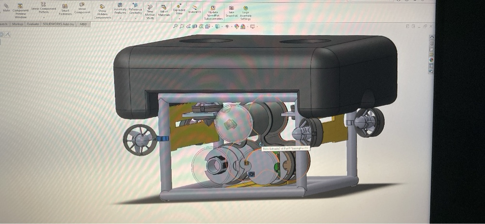
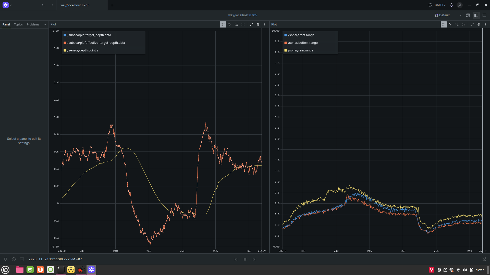
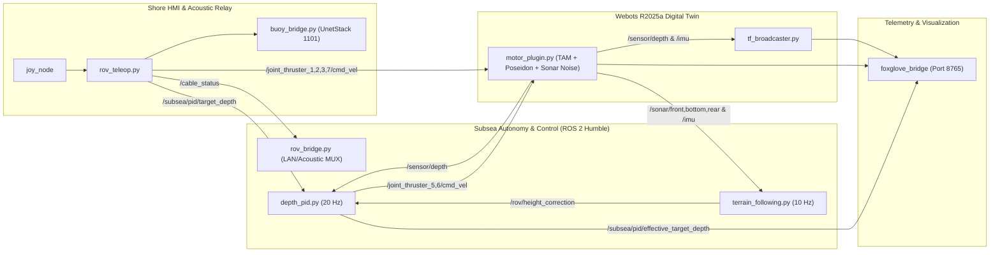
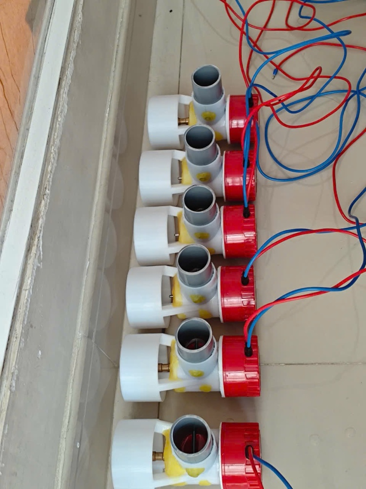

# ROS 2 SITL Digital Twin: From Physical Failure to 6-DOF Autonomy & Sonar Terrain-Following


*Phase 2: V2 Vectored Configuration - 6-DOF internal component layout optimized for neutral buoyancy.*

## Project Overview
This project documents the engineering evolution of a low-cost underwater robotics platform. Starting from a physical hardware prototype that failed hydrodynamically, the system was re-engineered into a **Simulation-First, Software-in-the-Loop (SITL) Digital Twin** built on **ROS 2 Humble**, **Webots R2025a**, **UnetStack**, and **Foxglove Studio**.

Rather than relying on trial-and-error fabrication, the Digital Twin validates hydrodynamic control, Thruster Allocation Matrices (TAM), acoustic/optical link switching, and real-time seabed terrain-following algorithms before hardware deployment.

### System Bring-up & SITL Demo
Watch the 6-DOF control, Poseidon disturbance injection, and tether failsafe demonstration:
[https://youtu.be/_uE3WmcvaT0](https://youtu.be/_uE3WmcvaT0)

---

## Core Technologies & Implemented Features (V2.1 SITL)

### 1. Autonomous 3-Beam Sonar Terrain-Following
- **Geometric Seabed Feature Extraction:** Integrates three downward-facing single-beam sonar sensors mounted at 60 deg (front), 90 deg (bottom), and 120 deg (rear) with a 30 deg beam aperture and 50 m max range.
- **6-Scenario Terrain Classification:** Projects slant ranges onto the vertical (X, Z) plane using real-time hull pitch feedback from the IMU, classifying seabed profiles into six canonical scenarios (*Steep Uphill, Narrow Trench, Steep Downhill, Small Mound, Gentle Uphill, Gentle Downhill*) and computing adaptive height corrections ($\Delta h$) with minimum clearance protection.
- **Realistic Underwater Acoustic Noise Model:** Simulates distance-dependent (heteroscedastic) Gaussian noise ($\sigma(d) = \sigma_0 + \eta d$) combined with a first-order Gauss-Markov bias drift process inside the Webots physics plugin.


*Webots R2025a simulation: ROV traversing a non-uniform ElevationGrid seabed with active 3-beam sonar rays and real-time scenario classification logs.*

### 2. Anti-Oscillation Depth PID with Target Override
- **Closed-Loop Depth Stabilization (20 Hz):** Automatically overrides the operator's base target depth (`/subsea/pid/target_depth`) with the sonar-derived height correction (`/rov/height_correction`) to produce an effective collision-avoidance setpoint (`/subsea/pid/effective_target_depth`).
- **Signal Conditioning:** Applies an Exponential Moving Average (EMA) low-pass pre-filter ($\alpha = 0.08$), integral anti-windup clamping ($\pm 5.0$), and filtered Derivative-on-Measurement ($K_p = 2.0, K_i = 0.05, K_d = 4.0$) to eliminate setpoint derivative kick and sinusoidal oscillations.


*Foxglove Studio real-time telemetry: Actual vehicle depth (`/sensor/depth.point.z`, yellow) smoothly tracking the effective target depth (`/subsea/pid/effective_target_depth`, orange) alongside synchronized 3-beam sonar range readings.*

### 3. 6-DOF Control, Fault Injection & Failsafe Architecture
- **Custom Thruster Allocation Matrix (TAM):** 6-DOF mixer for a vectored ROV layout (4 horizontal thrusters at 45 deg, 2 vertical thrusters), decoupling surge, sway, yaw, and heave motions.
- **SITL Environmental Fault Injection (Poseidon Node):** Custom Webots plugin injecting real-time sinusoidal tidal currents and Gaussian turbulence to stress-test closed-loop stability.
- **Asymmetric LAN/Acoustic MUX Bridge:** Monitors simulated fiber-optic tether health (`/cable_status`), automatically transitioning from high-bandwidth LAN teleoperation to a low-bandwidth UnetStack acoustic failsafe link upon tether loss.

---

## System Architecture



---

## The Roots: V1 Prototype & Engineering Lessons
This project originated as a collaborative hardware build using a low-cost PVC chassis. While V1 validated our electronic architecture and custom motor drivers, it failed hydrodynamically during pool trials.

<p align="center">
  
  
  
</p>
*V1 Build: PVC chassis, 1100 GPH bilge pump thrusters, and custom electronics stack.*

### Root Cause Analysis (RCA) - Why V1 Failed to Dive

*V1 Pool Test: Excessive positive buoyancy prevented the vehicle from submerging.*

1. **Uncompensated Positive Buoyancy:** The internal volume of the V1 acrylic enclosure generated upward buoyant force far exceeding initial estimates.
2. **Flow Rate vs. Static Thrust:** The 1100 GPH bilge pumps provided high volumetric flow but lacked sufficient static thrust (bollard pull) to overcome the excess buoyancy.

**Engineering Takeaway:** Hardware is unforgiving. This failure established the core workflow for V2: *model, simulate, and mathematically validate control and hydrodynamics before physical fabrication.*

---

## Repository Structure
```text
├── cad/                          # SolidWorks 3D assemblies & URDF exports
├── scripts/
│   └── start_all.sh              # Unified startup script (port cleanup, UnetStack, ROS 2 launch)
├── src/
│   ├── asem3/                    # Robot URDF description and 3D meshes
│   └── rov_brain/                # ROS 2 package (PID, TAM Teleop, Terrain-Following, MUX, Webots Plugin)
│       ├── launch/rov.launch.py  # Unified launch file for all ROS 2 nodes & Foxglove bridge
│       └── src/motor_plugin.py   # Webots physics, Poseidon disturbance, and sonar noise plugin
├── simulation/                   # Webots world files & UnetStack acoustic network scripts
└── docs/                         # V1 RCA assets, telemetry plots, and Foxglove layouts
```

---

## Quick Start

**Prerequisites:** Ubuntu 22.04, ROS 2 Humble, Webots R2025a, `foxglove_bridge`, UnetStack Community 3.4.4, and a USB Gamepad.

```bash
# 1. Clone and build the workspace
git clone [https://github.com/gouuchou123-ma/diy-underwater-rov-simulation.git](https://github.com/gouuchou123-ma/diy-underwater-rov-simulation.git) ~/rov_ws
cd ~/rov_ws
colcon build --symlink-install
source install/setup.bash

# 2. Option A: Launch the complete stack (UnetStack + ROS 2 + Foxglove Bridge)
chmod +x scripts/start_all.sh
./scripts/start_all.sh

# 2. Option B: Launch ROS 2 nodes and Webots controller only
ros2 launch rov_brain rov.launch.py
```

Open **Foxglove Studio** and connect via WebSocket to `ws://localhost:8765` to monitor real-time 3D TF transforms, depth PID tracking, and sonar telemetry.

### Gamepad HMI Controls
* **Horizontal Motion:** Left Stick (Surge / Sway) | Right Stick (Yaw)
* **Depth Setpoint:** `LB` (Descend) / `RB` (Ascend)
* **SITL Fault Injection:** `Y` / `X` (Enable / Disable Poseidon disturbance) | D-Pad Up / Down (Adjust storm intensity)
* **Tether Failsafe:** `B` (Simulate tether disconnect -> Acoustic failsafe) | `A` (Reconnect fiber-optic link)

---

## Future Roadmap

### Phase 3: 3D Perception & Safety Autonomy
- **3D Cross-Configured Sonar & SLAM:** Expanding the 2D vertical-plane sonar array to enable lateral obstacle avoidance (yaw/sway bypassing) and real-time seabed mapping on Foxglove Studio[cite: 5].
- **Autonomous Emergency Surfacing & Subsea EPIRB:** Computing safe vertical escape trajectories using sonar clearance data, paired with a simulated pop-up Emergency Position Indicating Radio Beacon (EPIRB) powered by a primary lithium cell for extreme tether-loss recovery[cite: 4].

### Phase 4: Relay Buoy USV Swarm
- **Hybrid Surface-Subsea Architecture:** Modeling an unsinkable surface relay USV (HDPE shell with closed-cell polyurethane foam core) communicating via RF to shore and via micro-tether fiber optics/acoustics to the ROV[cite: 4].

---

**Seeking Opportunities:** I am a 4th-year Automation Engineering student focusing on Control Systems, ROS 2, and Robotics Simulation. I am actively seeking an **Internship** or hardware collaboration to transition this validated SITL architecture into physical hardware.
