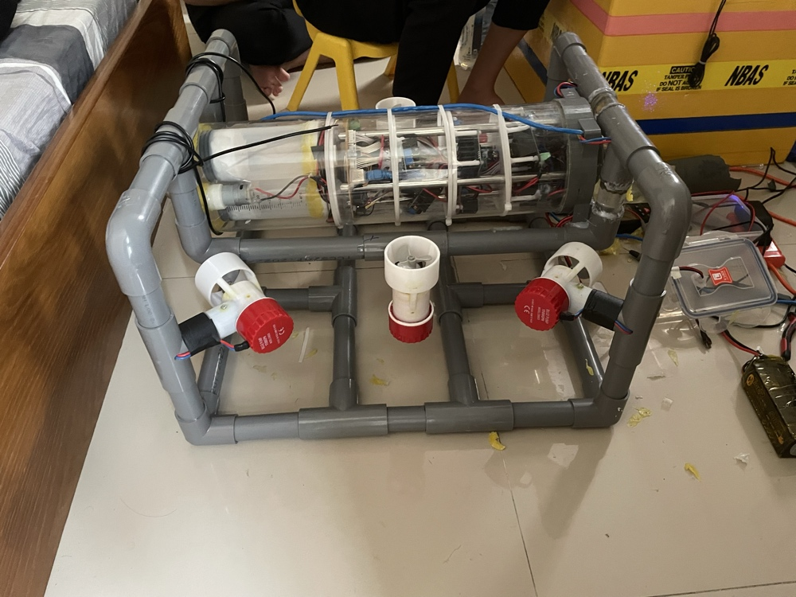
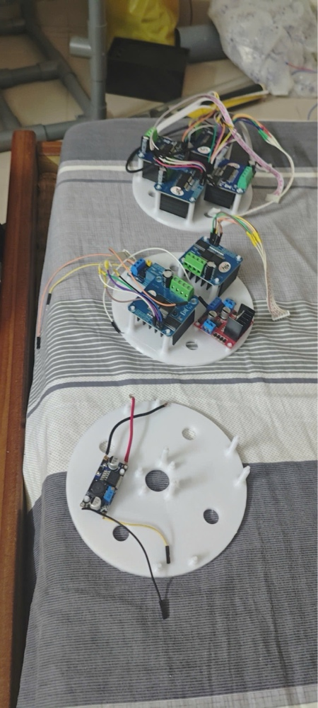

# 🌊 ROS 2 SITL Digital Twin: From Physical Failure to 6-DOF Autonomy


*Phase 2: V2 Vectored Configuration - Professional 6-DOF Internal Component Layout optimized for neutral buoyancy.*

## 🚀 Project Overview
This project chronicles the evolution of a low-cost underwater robotics system. Evolving from a flawed physical hardware prototype, it has been completely re-engineered into a **Simulation-First & Software-in-the-Loop (SITL) architecture**. 

Instead of guessing hardware parameters, the current system acts as a Digital Twin, leveraging ROS 2 and Webots to validate hydrodynamic control, Thruster Allocation Matrices (TAM), and autonomous fail-safe capabilities before any further physical fabrication.

### 🎬 System Bring-up & SITL Demo (The 60-Second Pitch)
**Watch the full 6-DOF and Failsafe Demonstration here:**  
👉 **[https://youtu.be/_uE3WmcvaT0]**

---

## 🌟 Core Technologies & Features (V2 SITL)
* **Custom Thruster Allocation Matrix (TAM):** Engineered a mathematically rigorous 6-DOF mixer for a Vectored ROV configuration (4 horizontal at 45°, 2 vertical), resolving cross-coupling forces for pure surge, sway, and yaw translations.
* **SITL Fault Injection (The Poseidon Node):** Built a custom Webots physics plugin that injects real-time hydrodynamic disturbances—including Gaussian turbulence and down-drafts—to stress-test the PID depth controller.
* **FDIR & Failsafe Logic:** Designed an asymmetric MUX bridge. When simulating a physical Fiber Optic tether loss, the system immediately strips teleop control and triggers an internal Watchdog to force an emergency surfacing maneuver.

---

## 🌱 The Roots: V1 Prototype & The Engineering Lesson
This journey began as a collaborative hardware build using affordable PVC chassis. While V1 successfully validated our electronic architecture and custom motor drivers, it failed hydrodynamically.

<p align="center">
  
   
  
</p>
*V1 Build: PVC frame, 1100 GPH Bilge Pump Thrusters, and custom electronic layers.*

### Root Cause Analysis (RCA) - Why V1 Failed to Dive


*V1 Pool Test: The system struggled to submerge due to overwhelming positive buoyancy.*

1. **The Buoyancy Trap:** The massive internal volume of the V1 acrylic enclosure created positive buoyancy that far exceeded our calculations.
2. **Flow Rate vs. Static Thrust:** We utilized 1100 GPH bilge pumps. While they moved high volumes of water, they lacked the Bollard Pull (Static Thrust) required to overcome the extreme upward buoyant force.

**The Takeaway:** Hardware is unforgiving. This failure drove the core philosophy for Phase 2: *Simulate, calculate, and mathematically validate the physics engine before cutting physical pipes.*

---

## 📂 Repository Structure
```text
├── cad/                      # SolidWorks 3D models & URDF Exports
├── src/                      
│   ├── rov_brain/            # ROS 2 Python packages (PID, Teleop, TAM, MUX Bridge)
│   └── webots_ros2/          # Webots-ROS 2 physics and interface configurations
├── simulation/               # UnetStack acoustic network environments
└── docs/                     # V1 RCA documents, images, and Foxglove layouts

```

## 🎮 Quick Start (Run the Simulation)

**Prerequisites:** Ubuntu 22.04, ROS 2 Humble, Webots R2025a, and a USB Gamepad.

```bash
# 1. Clone & Build
git clone [https://github.com/YourUsername/YourRepoName.git](https://github.com/YourUsername/YourRepoName.git)
cd YourRepoName
colcon build --symlink-install
source install/setup.bash

# 2. Launch the Subsea Brain & Webots Digital Twin
ros2 launch rov_brain rov.launch.py

# 3. Initialize HMI Teleop & Failsafe Watchdog
ros2 run rov_brain rov_teleop.py

```

> **Gamepad HMI Controls:**
> * **Movement:** Left Stick (Surge/Sway) | Right Stick (Yaw)
> * **Depth Control:** LB (Dive) / RB (Surface)
> * **SITL Injection:** `Y` (Summon Hydrodynamic Storm), `B` (Simulate Tether Cut -> Triggers Emergency Surfacing).
> 
> 

---

## 📈 Future Roadmap

### Phase 3: Perception & Mapping

* **Sonar Integration:** Implementing 2D Sonar models in Webots for real-time obstacle mapping on the Foxglove HUD.

### Phase 4: The "Relay Buoy" USV Swarm

* **Physicalizing the Hybrid Architecture:** Designing an unsinkable Surface Relay Buoy (USV) with closed-cell polyurethane foam to communicate via RF to the shore, bridged by a micro-tether Fiber Optic cable to the ROV.

> **📢 Seeking Opportunities:** I am a 4th-year Automation Engineering student specializing in Control Systems and Systems Architecture. I am actively seeking an **Internship** or hardware sponsorship to bring this validated SITL architecture back into the physical realm. Let's connect!
